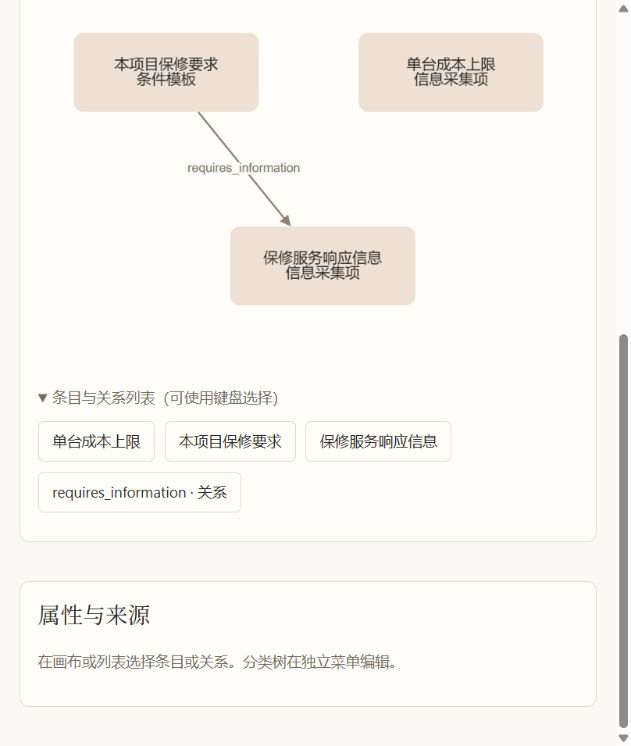
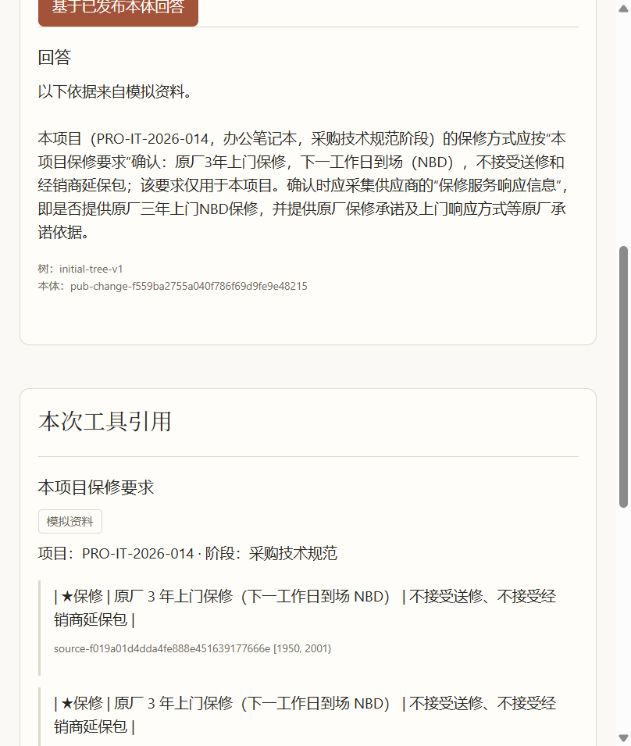

# MVP 本地技术验收记录

日期：2026-10-20。范围：`test_buyer1`、`test_supplier1` 的 `computer`，本机单进程服务。技术验收包含真实模型、真实 TDB2、API/MCP、浏览器和恢复；**业务专家尚未正式验收材料解释、候选质量和 schema 草案**。

## 1. 实际部署

| 项目 | 实际值 |
| --- | --- |
| 页面、API、MCP | `http://127.0.0.1:8002`，FastAPI 单进程 |
| 模型 | `deepseek/deepseek-flash`，真实提供方调用 |
| Python / Node | Python 3.13 / Node 24.21.0 |
| Fuseki | Apache Jena Fuseki 6.2.0，Java 21，Ubuntu WSL Docker |
| 容器 / 端口 | `procurement-ontology-fuseki-1` / `127.0.0.1:3032` |
| 镜像 ID | `sha256:79915711b7359174eb045c93cca61bafff352ea29af76e514f2b55f4a68f2334` |
| 持久卷 | `procurement-ontology_fuseki_data` |
| 启用 schema | 两家均为独立的 `computer/v1`；模型生成的 v2 未启用 |

凭据只保存在忽略 Git 的本机运行文件或既有凭据系统，未写入本记录。演示账号保存在 `services/procurement_ontology/runtime/demo-accounts.json`，请在本机查看。原 OntoGPT Web 演示与该服务独立。

## 2. 两份材料的真实提取

| 指标 | 甲方 `test_buyer1` | 乙方 `test_supplier1` |
| --- | --- | --- |
| 原文 | `tests/fixtures/procurement/laptop-purchase-case.md` | `services/procurement_ontology/tests/fixtures/supplier-laptop-bid-case.md` |
| SHA-256 | `af2a287082514526ff4413900efae65af99b4c10827db619caecb290e8f5ed45` | `f435bbd2439f736aa0ebeb0c05e642eedf3092145a5d21006ae997ec9484f346` |
| 模型状态 | SUCCEEDED | SUCCEEDED |
| 候选 / 有定位原文 | 42 / 34 | 40 / 25 |
| 类型分布 | CollectionField 9、ConditionTemplate 23、TermDefinition 3、ProcessNote 4、关系 3 | InternalCost 14、DeliveryServiceCapability 3、ProductOffering 1、PricingStrategy 6、QualificationStatement 3、ProjectEvidence 3、CompanyStatement 5、BrandAuthorization 2、关系 3 |
| 输入 / 输出 tokens | 13952 / 8889 | 18761 / 8521 |
| finish_reason | stop | stop |

测试逐项比较所有已定位候选的 `quote == text[start:end]`。不能唯一定位的候选保留为建议，不能直接发布。完整的脱敏摘要见 [真实提取证据](evidence/2026-10-20/live-acceptance-evidence.json)。

贯通测试对每家各一个条目进行**自动化技术验收中的模拟人工审核**，其余拒绝后发布，以检查治理链路。甲方选择 CollectionField“单台成本上限”；乙方选择 InternalCost“物流 + 卸货搬运”。这不是业务专家对全部 82 个候选的审核，也不代表案例公司事实真实。

首次真实请求遇到 DeepSeek 默认 thinking 消耗输出预算，响应 `length` 导致 JSON 截断。增加回归测试后，仅 DeepSeek 结构化客户端显式使用 `reasoning_effort=none`；截断运行保持 FAILED，不接受部分候选。原始响应、model_id 和 token 元数据只保留在所属企业未发布运行中。默认行为依据：[DeepSeek 官方文档](https://api-docs.deepseek.com/guides/thinking_mode/)。

失败重试保持同一个 run ID，但使用新的不可变候选批次，避免上次部分写入污染本次审核；真实 TDB2 中注入“写完首个候选即断开”已复现并修复。

## 3. 浏览器实操

| 身份 / 操作 | 实际结果 |
| --- | --- |
| 平台管理员 | 只显示通用管理；在独立树菜单将“办公设备”改名、核对差异、确认发布，再通过第二次发布恢复名称。两家既有企业仍为 `initial-tree-v1`。 |
| 甲方企业管理员 | 实际提取记录可见；通过画布新增两条有原文和项目范围的条目及 `requires_information` 关系，保存待审、查看差异后发布。Cytoscape 实际显示 3 个节点和 1 条连线。 |
| 甲方 Agent | 发布前对保修问题明确无依据；发布后回答原厂 3 年上门 NBD、拒绝送修/经销商延保，引用实际工具返回的条目和 `[1950,2001)` 原文，标记模拟和项目范围。 |
| 甲方 Schema 改进 | 输入自然语言要求新增 `conflicts_with`，模型生成独立 v2 YAML/Python；界面显示 DRAFT 和 Git 差异，启用版本仍为 v1。使用已存在的合法端点与来源提交该未启用关系，实际 API 返回 422，当前版本不变。 |
| 乙方企业管理员 | 只显示自己的企业；画布可见内部成本“物流 + 卸货搬运 3,000”、`BID-IT-2026-014`、成本测算阶段及原文 `[3837,3864)`；没有固定甲方 Agent 菜单。 |

甲方保修的两个条目及其关系是**浏览器手工编辑、原文支持的测试数据**，不能算作模型自动提取的成功样本。





浏览器检查采用约 646px 宽的实际侧栏视口；已检查响应式排版。其他视口的全量人工视觉验收未进行。完整可访问文本见同目录的 `buyer-agent.ax.txt`、`supplier-cost.ax.txt`、`buyer-schema-draft.ax.txt`。

## 4. 权限、查询、发布与 schema

- 实际 HTTP MCP `tools/list` 恰好为 `search_ontology_items`、`get_ontology_item`；逐条比较 API/MCP 的内容、来源和版本一致。详情见 [查询证据](evidence/2026-10-20/runtime-query-evidence.json)。
- 实际 API：企业猜测另一企业条目 ID 返回 404；平台访问企业知识返回 403；乙方调用固定甲方 Agent 返回 403。服务端测试另覆盖伪造 scope、关系端点、来源、只读账号写入和 CSRF。
- 真实 TDB2 测试覆盖更新后运行期 LOAD 故障回滚、并发完整读取、同基础版本只能一个发布成功、条件未命中即使 HTTP 200 也不能当成功、跨树/本体版本对冲突。
- SQLite 激活指针与审计同事务；通过审计触发器故障验证回滚。实际认证 CLI 对两家的已部署 v1 激活成功；新版本部署/旧任务固定版本采用隔离测试产物验证。
- 真实模型共生成 6 个独立待审草案：甲方 2 个新字段及 `conflicts_with`；乙方 3 个新字段。重复 LinkML 生成字节一致，移除模型凭据的子进程可导入并验证根模型；各草案已在 `D:/Code/procurement-schema-drafts` 的独立 Git 分支提交。见 [草案证据](evidence/2026-10-20/draft-review-evidence.json)。
- **未收到人类对 v2 草案的 Git 审核批准，没有部署或激活这些草案。** 同企业多个 v2 草案需要人工合并、重新生成和测试。甲方草案描述包含案例 5 人、20% 等信息，审核时须判断如何泛化，不能变成默认门槛。

## 5. 实际重启及 CLI 双库恢复

停止自己的服务进程后执行：

```powershell
uv run --project services/procurement_ontology procurement-service backup --destination services/procurement_ontology/runtime/backups/acceptance-20261020
uv run --project services/procurement_ontology procurement-service restore services/procurement_ontology/runtime/backups/acceptance-20261020/manifest.json --destination services/procurement_ontology/runtime/restored-20261020 --dataset-prefix restored20261020_
wsl -d Ubuntu -- docker restart procurement-ontology-fuseki-1
```

恢复到空目标，不覆盖原始数据集。实际比较平台和两企业的当前版本、查询结果、来源、运行、变更批次、草案、历史快照，以及 SQLite 账号/企业/启用指针/两条激活审计，全部相等。用恢复目录启动服务后，实际 HTTP API/MCP 比较再次通过。详情见 [恢复证据](evidence/2026-10-20/recovery-evidence.json)。

维护闸门拒绝新写入并排空在途请求、失败恢复禁止启用、文件篡改/缺失拒绝等反例另由真实数据库集成测试验证。未验证跨机器灾难恢复和多实例写入；本 MVP 明确只支持本机单进程。

## 6. 自动测试和运行方法

```powershell
$env:FUSEKI_TEST_URL = 'http://127.0.0.1:3032'
uv run --project services/procurement_ontology pytest services/procurement_ontology/tests -q
npm test --prefix frontend/procurement-ontology -- --run
npm run build --prefix frontend/procurement-ontology
git diff --check
```

实际结果：服务全套 **113 passed、1 skipped**；跳过项是默认不触发付费调用的真实模型贯通测试。77 个依赖弃用警告，主要为 RDFLib N-Quads 内部 `default_context`，另有已有依赖警告。前端 **12 passed**，生产构建通过。根工程原有离线单元基线 **69 passed、10 skipped**；未盲跑需要外部模型的根集成测试。

真实模型贯通单独显式运行，结果 **1 passed in 76.80s**：

```powershell
$env:PROCUREMENT_LIVE_ACCEPTANCE_URL = 'http://127.0.0.1:8002'
$env:PROCUREMENT_LIVE_CREDENTIALS_FILE = '本机 runtime/demo-accounts.json 的绝对路径'
uv run --project services/procurement_ontology pytest services/procurement_ontology/tests/integration/test_acceptance.py -q
```

该测试会调用真实模型，并对专用演示数据模拟审核和发布；不要把它指向业务生产库。源资料为模拟样本，技术通过不能代替业务专家逐项审核、抽取质量评测和生产上线评审。

## 7. 独立整分支审查与修复

独立审查复跑 49 项存储、治理、身份/查询、提取、激活和恢复测试通过，发现 3 项 Important、无 Critical：过期候选批次无法继续审核、重复品类键覆盖检索入口、恢复前缀重叠污染后续备份。三项均先用隔离真实 TDB2 或界面测试复现，再修复；后端针对性回归 6 passed、前端全套 12 passed、生产构建通过。修复后服务全套 113 passed、1 skipped。未进行第二次审查，不把实现者验证写成独立复审。

审核重启是明确的用户操作，清空旧决定并保留审计，仍拒绝直接发布旧版本。品类键拒绝绑定到其他节点。恢复在导入前拒绝源/目标前缀相同或互为前缀。

暂缓 1 项 Minor：MCP 对“另一企业实际存在记录”的专门负向覆盖尚缺；已有代码共享授权查询与实际 API 越权测试，独立审查未发现当前越权实现。完整决定、未判断边界与代价见[实施决策](implementation-decisions.md)。

迁移后再次在当前工程实操浏览器，发现随机 CoSE 布局偶尔重叠矩形节点；使用真实 Cytoscape 引擎和固定随机序列复现后，改为确定性的 breadthfirst 有向布局。前端全套 12 passed、生产构建通过；该修复不改变本体数据、版本或权限。
