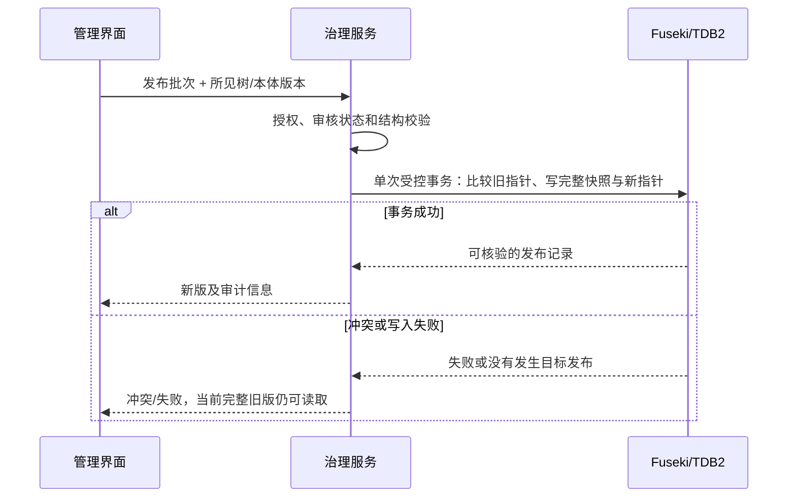
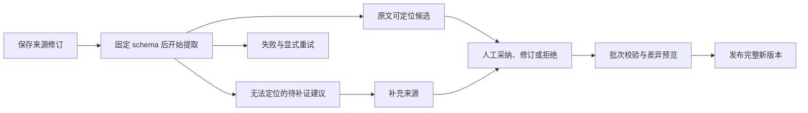

# 详细设计

状态：待本轮文档评审。本文细化 [MVP 设计](../superpowers/specs/2026-10-19-procurement-ontology-mvp-design.md)，接口和表结构均为实施契约，尚未实现或验证。

## 1. 术语与标识

| 名称 | 含义与约束 |
| --- | --- |
| `scope_id` | 服务端身份确定的数据域；取 `platform` 或企业 ID，如 `test_buyer1`。不等于业务适用范围。 |
| `company_id` | 企业 ID；平台账号的该字段为空。企业 schema 激活只能指向账号绑定的企业。 |
| `category_key` | schema 配置使用的稳定键，如 `computer`。与企业树节点 ID 映射，不从显示标签推断。 |
| `category_id` | 某企业树实例中的稳定节点 ID。改名或调整同层合法父级不更换此 ID。 |
| `schema_version` | 企业/二级品类提取规范版本，如 `v1`；SQLite 保存启用指针。 |
| `tree_version` / `ontology_version` | 各数据域内独立发布的树、本体完整快照 ID；Fuseki 保存当前指针。 |
| `scope` | 知识条目的业务适用范围，包括项目、设备类型、采购阶段和有效期。 |

服务端生成条目、关系、来源、批次和版本 ID。模型输出的名称、外部公司名称或临时引用不能直接充当企业 ID、图名、数据集名或 SPARQL 片段。

资料中提到客户或竞争对手，只会形成当前企业资料中的实体提及及陈述，不会因此开通新企业、关联另一企业数据集，或获得访问另一企业的权限。

## 2. 核心数据对象

| 对象 | 主要字段 | 管理规则 |
| --- | --- | --- |
| `Identity` | `account_id`, `scope_id`, `role` | 由认证结果构造，不能被请求体覆盖。 |
| `SourceRevision` | `id`, `scope_id`, `text`, `sha256`, `simulated`, `submitted_by`, `created_at` | 原文修订不可改；补充材料形成新修订。 |
| `SourceSpan` | `revision_id`, `start`, `end`, `quote` | `quote == text[start:end]`；位置指向已保存原文。 |
| `ExtractionRun` | `id`, `revision_id`, `category_key`, `schema_version`, 文件摘要、模型配置标识、状态 | 开始时固定 schema，不随中途激活变化；不记录模型密钥。 |
| `CategoryNode` | `id`, `level`, `parent_id`, `label` | 根级无父级；其他级唯一父级；只有三层。 |
| `KnowledgeItem` | `id`, `kind`, `label`, `description`, `category_id`, `scope`, 业务属性、来源引用 | 业务属性按创建它的 schema 版本校验。 |
| `KnowledgeRelation` | `id`, `subject_id`, `predicate`, `object_id`, 来源引用、适用范围 | 主客体、关系类型和数据域均校验；关系自身也要有依据。 |
| `Candidate` | `id`, 提取条目或关系、证据状态、审核状态、原始运行 | 模型输出不等于已确认事实；修订保留原候选。 |
| `ChangeBatch` | `id`, `scope_id`, `kind`, 基础版本、变更操作、审核结果 | `kind` 为树或本体；只有发布后才影响普通查询。 |
| `PublishedSnapshot` | `id`, `kind`, 完整内容、前版、批次、操作者、时间、schema/来源引用 | 成功发布后不可改。 |

所有可发布知识条目预留 `access_policy_ref: null`。MVP 不在抽取 YAML 中要求模型输出该字段，也不根据该字段作权限判断。企业边界和管理权限从第一版起执行。

`SourceSpan` 的位置由服务端按保存的 Unicode 文本计算，采用 Python 字符索引，结束位置不包含在片段内；不能混用字节、浏览器 UTF-16 偏移或规范化后的文本位置。换行、全角字符等变化不能悄悄改写原文。重复摘录需要明确位置；无法唯一定位时留待补证。

## 3. SQLite 管理模型

| 表 | 关键列及约束 |
| --- | --- |
| `companies` | `company_id` 主键、开通状态、数据集标识、采用的平台树/本体版本、创建时间；开通状态为 `PROVISIONING`、`READY` 或 `FAILED`。 |
| `accounts` | `account_id` 主键、用户名、密码散列、角色、可空 `company_id`、启用状态；企业账号必须绑定一个企业。 |
| `sessions` | 会话令牌摘要、`account_id`、失效时间；不保存可直接使用的原始令牌。 |
| `service_tokens` | 令牌摘要、绑定账号、失效/撤销状态；MCP 服务身份也必须绑定唯一企业。 |
| `active_schemas` | `(company_id, category_key)` 唯一键、版本、YAML/Python 摘要、激活者、激活时间。 |
| `schema_activation_audit` | 操作 ID、企业、品类、前版、新版、已部署产物摘要、操作者、时间。 |

密码使用带独立盐值的密码散列；会话和服务令牌按摘要查找。浏览器使用同源会话，写操作检查请求来源及会话状态；部署时按传输环境设置 cookie 安全属性。日志不打印密码、令牌、模型密钥或完整业务材料。

初始平台管理员由本地受控初始化操作创建，只在尚无平台管理员时允许执行。后续企业开通走平台系统入口并记录审计；不能依靠浏览器自报管理员角色创建身份。

激活事务为：验证身份与版本产物 → 开始 SQLite 写事务 → 更新 `active_schemas` → 追加审计 → 提交。任一步失败都回滚。文件校验和导入检查成功不代表 Git 审阅或测试已经发生，审核人须在部署前确认这些步骤。

时间以带时区的 UTC 值保存，界面按用户环境显示。SQLite 不另存一份业务本体、候选或全文，避免形成两个业务真相源。

## 4. Fuseki 数据集与具名图

平台使用独立数据集；甲乙企业分别使用自己的数据集。只有服务根据已验证身份取得数据集句柄，浏览器和模型不接收可自由替换的数据集 URL。

| 具名图用途 | 内容与可变性 |
| --- | --- |
| 控制图 | 当前树/本体版本指针、`category_key` 到本企业节点 ID 的映射、初始化来源版本。 |
| 来源修订图 | 原文、校验值、提交身份、模拟标记及来源片段；修订内容不可改。 |
| 提取运行图 | 所用 schema/模型标识、状态和候选引用；状态变化留事件记录。 |
| 待审批次图 | 本体或树的变更操作、基础版本、逐项审核结果。 |
| 树版本图 | 已发布三级分类树完整快照。 |
| 本体版本图 | 已发布条目、关系及治理元数据完整快照。 |
| 审计图 | 审核、修改、发布、初始化等操作的主体、时间及前后引用。 |

图名采用服务生成的内部标识。`rdf_codec.py` 负责稳定 ID 和 RDF 往返映射，`store.py` 是受控读写入口；API 不接受原始 SPARQL。业务属性、来源链接和模拟标记在往返后须保持完整。

新企业初始化固定同一时点读取的平台树和本体版本，再复制需要的节点、关系及来源闭包到企业数据集，重写为企业命名空间内的引用。复制结果记录模板来源版本，不依靠后续动态读取平台当前图。只有快照和账号开通均完成后才标记 `READY`。

SQLite 与 Fuseki 之间不假设存在跨库事务。开通过程使用企业 ID 和固定模板版本幂等重试；中途失败保持 `FAILED` 或 `PROVISIONING`，不向企业账号开放半初始化数据。重试不得新增第二套初始树。

## 5. 两类编辑与发布校验

企业管理员在独立树菜单提交 `add_node`、`update_node`、`remove_node` 及合法父级调整。服务校验层级、唯一父级、无环、节点存在性、数据域和当前版本。被当前已发布本体引用的节点不能删除；先发布移除或迁移引用的新本体，再发布删节点的新树。

企业画布提交 `add_item`、`update_item`、`remove_item`、`add_relation`、`update_relation`、`remove_relation`。条目只能归属已发布的本企业品类节点；新增关系必须属于该企业该品类当前已启用 schema 允许的关系类型，并满足主客体类型。仅部署但尚未激活的新版不能授权新关系。画布没有树节点增删改或 schema 修改操作。

人工输入也需要证据。已有材料可直接引用片段；管理员补充的新陈述先形成一条来源修订，再引用该修订。没有依据的修改可以保留为待补证建议，不能发布。树节点的命名和层级修改记录管理员操作依据，不要求模型提供事实证据。

发布前校验来源闭包、企业归属、关系引用、范围、有效期、尚未处理的冲突和审核状态。项目报价不同轮次用阶段区分；同项目、同阶段、同口径的互相矛盾金额不能由模型任取其一。冲突候选保留原始记录并交给人工补充来源，未解决前不能作为已确认的单一数值事实发布。

## 6. 发布事务与读一致性



以上是待验证的协议要求，不是对某段尚未实现 SPARQL 的正确性声明。版本比较与写入必须发生在同一写事务内。条件未命中时可能仍收到 HTTP 成功响应，存储入口必须核对本次发布记录，而不能只检查状态码。并发两个基于同一旧版的发布只允许一个成功。

普通读取在一次受控查询中固定当前 `ontology_version` 和 `tree_version`，使用这对版本解析条目、关系和分类路径，并把两者返回给客户端。本体快照另记录发布时采用的树版本用于历史溯源。树后续改名不会丢失本体中的稳定分类 ID。

搜索后再读取详情时携带所见版本对；若任何指针已变化，返回 `409 VERSION_CHANGED`，要求刷新搜索。待审批次修改带基础版本；过期提交返回 `409 STALE_BASE_VERSION`，不能覆盖新发布结果。历史读取仅用于授权管理和审计，不混入普通搜索。

## 7. 提取、重试与审核状态



运行状态使用 `PENDING → RUNNING → SUCCEEDED/FAILED`。进程重启把遗留 `RUNNING` 标记为中断失败，保留来源和已记录诊断，允许显式重试。重试去重以来源修订、schema 版本和抽取语义为依据；切换 schema 后可以产生新运行，但不能重复发布同一候选。

证据状态与审核状态分别记录。候选可处于 `PENDING_REVIEW`、`ACCEPTED`、`REJECTED`；缺少原文依据的内容标为 `MODEL_SUGGESTION` 并保持待补证，不能靠点击“采纳”跳过证据检查。

抽取适配器每次创建独立 `SPIRESEngine`，传入注册表加载的模板绑定，并在原始保存文本上重新核对证据。不得使用引擎清理后的字符偏移直接定位原文；不得让引擎日志输出乙方全文、成本和策略内容。

## 8. Schema 注册、草案与激活

注册表以 `(company_id, category_key, schema_version)` 为键，登记相对 YAML/Python 路径、根类、文件 SHA-256、生成器版本及导入依赖摘要。目录扫描、文件修改时间和模型建议不决定当前启用版本。

两个企业根类分别为 `BuyerComputerExtraction`、`SupplierComputerExtraction`，各自字段见 [schema 说明](schemas/README.md)。LinkML 描述提取形状和提示语；通用来源、审核、版本和权限元数据由服务维护。企业目录中的 Python 由 LinkML 生成，运行时不重新生成，也不导入未部署草案。

自动缺口流程为：资料或自然语言新陈述 → 模型提出未映射字段/关系和证据 → 服务与当前 schema 比较 → 记录缺口 → 在指定独立待审 Git 工作树生成新 YAML → LinkML 生成 Python → 展示差异与测试结果。只允许增加字段或关系；删除、重命名、类型变化、跨企业引用被拒绝。

待审工作树必须与运行服务工作树分离。模型只能产生受约束的 schema 建议，不能指定任意路径、Shell 命令或 Python 源码。生成和导入测试在无业务凭据的测试环境执行，正式服务只导入 Git 审阅、测试并部署的产物。

```text
已部署 v1 + SQLite 启用 v1
  → 自动起草 v2（v1 保留，启用指针不变）
  → Git 审阅、生成和回归测试
  → 部署 v2 文件及注册表（仍启用 v1）
  → activate-schema test_buyer1 computer v2
  → 新提取任务固定 v2；运行中的 v1 任务继续使用 v1
```

## 9. API、MCP 和命令契约

下表是拟定路由；数据域来自会话或服务令牌，管理请求不能靠一个任意 `scope_id` 参数切换身份。

| 入口 | 用途及访问范围 |
| --- | --- |
| `POST /v1/session`、`DELETE /v1/session`、`GET /v1/me` | 登录、退出和当前身份；不返回凭据摘要。 |
| `POST /v1/platform/companies` | 平台触发系统开通与初始实例化，只返回开通元数据。 |
| `GET/POST /v1/manage/sources` | 本企业来源列表和提交；正文仅管理权限可取。 |
| `POST /v1/manage/sources/{id}/extract` | 请求携带本企业 `category_key`，创建提取运行；返回运行 ID，状态从运行详情读取。 |
| `GET /v1/manage/runs/{id}`、`GET /v1/manage/batches/{id}` | 本企业提取和待审批次状态。 |
| `POST /v1/manage/batches/{id}/reviews` | 采纳、修订、拒绝和补证。 |
| `GET/POST /v1/manage/tree`、`POST /v1/manage/ontology/changes` | 企业树变更和企业本体变更；分别校验请求操作类型。 |
| `POST /v1/manage/batches/{id}/publish` | 发布本企业已验证批次。 |
| `/v1/platform/tree`、`/v1/platform/ontology/changes`、`/v1/platform/batches/{id}/publish` | 平台专用读取、编辑和发布；不接受企业数据域。 |
| `POST /v1/manage/schema-gaps`、`GET /v1/manage/schema-drafts/{id}` | 自然语言新增建议及本企业草案状态。 |
| `POST /v1/manage/schemas/activate` | CLI 调用的本企业激活操作；CLI 命令参数中的公司须与身份一致。 |
| `GET /v1/ontology/items?q=...&category_key=computer` | 本企业当前已发布知识搜索，返回摘要、版本对和实际分类路径。 |
| `GET /v1/ontology/items/{id}` | 带所见版本对读取详情、一跳关系和获准来源片段。 |
| `POST /v1/agent/questions` | 只有甲方测试账号可调用固定甲方知识包的演示 Agent。 |

管理权限和普通读取权限分别检查。未登录为 `401`，无权操作为 `403`；猜测他企条目 ID 与本企业不存在的条目均返回不泄漏存在性的 `404`。校验失败为 `422`，并发版本冲突为 `409`。错误正文包含稳定 `code`、中文说明和请求标识，不包含对方公司名称、原文或内部查询。

MCP 只暴露 `search_ontology_items(query, category_key)` 和 `get_ontology_item(item_id, observed_version)`；公司和权限不作为模型自由填写的参数。两者调用 `KnowledgeQuery`，与 JSON API 共享过滤、版本和来源逻辑。MVP 从条目标签、说明和业务字段做文本检索，不额外引入向量库；自然语言问题可由 Agent 转成工具查询。

管理命令为 `activate-schema <公司> <二级品类> <版本>`；其中二级品类使用稳定 `category_key`，示例为 `computer`。备份与恢复命令仅面向部署操作人员，恢复不开放给企业网页。

## 10. LangGraph 回答契约

流程为搜索 → 读取命中详情 → 基于本次工具输出组织回答。服务固定甲方企业和电脑品类，模型或浏览器不能传入另一个企业。未命中时明确说明未找到依据；不得查询乙方成本作为甲方答案。

返回 `answer`、`citations[]` 和实际版本对。引用由工具返回的条目 ID、来源片段和版本组装，不能只相信模型自报的引用。测试既检查引用确实来自工具结果，也人工核对回答与材料是否一致；引用 ID 正确不等于每一句回答必然正确。

## 11. 备份、恢复与故障边界

维护窗口先拒绝新写入，再等待进行中的写入结束，然后备份 SQLite 及平台、企业 Fuseki 数据集。备份清单记录 schema 部署版本、各数据集、文件摘要和时间，运行模型密钥不打包进备份文件。

恢复先验证清单完整性和摘要，再恢复 SQLite 与所有关联数据集；缺少任一部分拒绝作为完整恢复。恢复到本项目指定目标，不能覆盖其他服务的卷。验收核对当前指针、历史版、来源、草案/审核状态、schema 启用指针和操作人审计。

MVP 未引入跨实例协调或分布式任务系统；如果以后部署多个服务写入进程，需要重新设计维护窗口协调、提取任务持久执行和发布并发控制。当前实现不能凭单进程测试宣称支持多实例部署。
