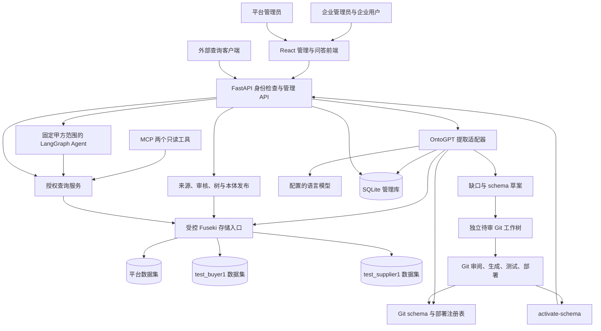
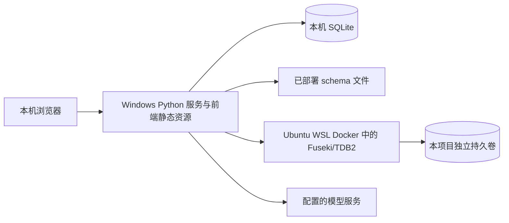

# 系统架构

状态：待本轮评审的目标架构。图中的组件和连接尚未代表已部署服务。

## 组件及数据流

箭头表示调用关系，未授予调用方选择任意数据集的能力。所有入口都由服务端身份决定数据域；Fuseki 凭据只保存在服务配置中。部署初期不把 Fuseki 或 SPARQL 端点提供给浏览器、模型或外部 Agent。

## 权威数据与版本

| 对象 | 权威位置 | 改变方式 |
| --- | --- | --- |
| 企业提取规范及生成代码 | Git 中独立版本的 YAML/Python | 草案、Git 审阅、测试、部署。 |
| 可部署 schema 清单 | 已部署 `schema_registry.yaml` | 随部署更新，按哈希验证。 |
| 每企业/二级品类启用 schema | SQLite | 授权 `activate-schema`，指针和审计同一事务。 |
| 来源、候选、审核轨迹、企业树、本体 | 对应企业 Fuseki/TDB2 数据集 | 追加修订、待审批次、发布不可变版本。 |
| 通用树及通用本体 | 独立平台 Fuseki/TDB2 数据集 | 平台管理员审核发布新版本。 |
| 当前树/本体发布指针 | 各自 Fuseki 数据集的控制图 | 与新快照在同一已验证写事务中提交。 |
| 账号、会话与企业开通状态 | SQLite | 受控管理操作，不保存业务知识副本。 |
| 画布位置与未保存表单 | 前端临时状态 | 不决定知识是否生效。 |

Schema 启用和本体发布是两条独立版本线。部署了 `v2` 不代表启用了 `v2`；启用了 `v2` 也不会改变已发布本体。新提取运行固定新 schema 后，仍须经过来源校验、审核和本体发布才能影响查询。

## 平台与企业边界

平台工作区管理通用本体、通用三级树及系统开通元数据。企业工作区管理本企业资料、本体和三级树。平台账号不具备进入企业业务知识读写 API 的权限；企业账号也不能切换到平台或另一企业。

每家企业在开通时，从平台当时已发布的通用本体和通用树创建自己的实例。复制包含需要的来源闭包，并重建企业内 ID/引用；记录平台来源版本作为溯源元数据。企业后续查询不依赖一条可变的跨数据集引用，因此平台更新不会悄悄改变企业知识。

平台初始通用本体采用空快照，避免预置未经确认的企业事实；试点通用树包含已确认路径 `IT与通讯 → 办公设备 → 电脑(台式机/笔记本)`。平台可在自身工作区补充通用知识。复制通用数据不复制或共享企业提取 schema，每家公司仍维护自己的 YAML/Python。

## 编辑与发布边界

企业本体画布修改知识条目、schema 已允许的关系和条目对既有品类节点的归属。分类树节点的增删改在独立树形菜单完成。两种界面提交变更操作，服务端记录来源、操作者、所见版本和差异，再审核与发布。

平台通用本体和通用树使用独立管理入口，写入平台数据集。平台管理员对企业的初始化只触发系统规定的实例化流程，不能借此任意编辑已有企业数据。

Schema 的字段和关系类型不在画布或树菜单修改。表达能力不足时产生缺口草案，经过 Git 审阅等步骤后才能启用新提取规范。

## 本地运行拓扑

开发时 Vite 通过代理访问 FastAPI，生产构建由 Python 服务同源提供。Fuseki 只对本机服务开放；实施前核对已有端口、容器和卷，再记录本项目的镜像版本和连接方式。Windows 到 WSL 的连通性以及重启后的连接行为均属于实测项。

## MVP 运行约束

采用单服务进程协调抽取、审核、发布和维护窗口，不引入分布式任务队列。提取运行状态先持久化，进程重启后把中断运行标记为可显式重试的失败；不得把未完成运行标成成功。每次提取使用独立引擎实例，避免可变的提取状态或模型结果在企业间复用。

发布存储入口必须验证并发写入、比较所见版本、失败回滚和原子可见性。HTTP 成功状态或设计图不能代替这项证明；具体试验见 [验收矩阵](review-and-validation.md)。
